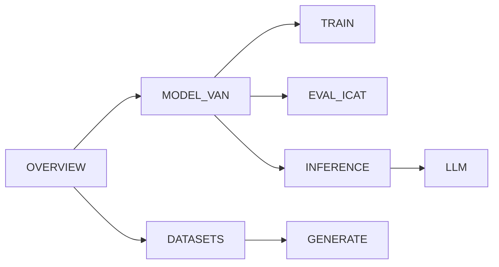

# FAIRAI / VAN

Reproducible stereotype / bias classification (master’s thesis FAIRAI), rewritten as a Clean Architecture package with Docker Compose and frozen **VAN v2**.

> Stereotypical/toxic text may appear — research use only. See [NOTICE.md](NOTICE.md).

## Status

| Milestone | State |
|-----------|--------|
| M0–M8 (import → Release) | **done** — [repo](https://github.com/dany27041991/fairai) · [v0.1.0](https://github.com/dany27041991/fairai/releases/tag/v0.1.0) |
| Anti-regression vs notebooks | **PASS** (A–C blockers) — [docs/verification](docs/verification/00_INDEX.md) |

## Quick start

```bash
cd fairai && python -m venv .venv && source .venv/bin/activate
pip install -e ".[torch,dev]"
make import-asis ASIS_ROOT="../TESI MAGISTRALE"
make smoke
fairai icat --subset all --baseline configs/baselines/baseline_van_v2_icat.json
```

## Documentation (from thesis notebooks)



| Topic | Doc |
|-------|-----|
| Pipeline & labels | [docs/OVERVIEW.md](docs/OVERVIEW.md) |
| Notebooks → code | [docs/NOTEBOOKS.md](docs/NOTEBOOKS.md) |
| Datasets / leakage | [docs/DATASETS.md](docs/DATASETS.md) |
| VAN architecture | [docs/MODEL_VAN.md](docs/MODEL_VAN.md) |
| Train | [docs/TRAIN.md](docs/TRAIN.md) |
| ICAT / StereoSet | [docs/EVAL_ICAT.md](docs/EVAL_ICAT.md) |
| Infer / thresholds | [docs/INFERENCE.md](docs/INFERENCE.md) |
| Generation | [docs/GENERATE.md](docs/GENERATE.md) |
| LLM few-shot / PPO | [docs/LLM.md](docs/LLM.md) |
| Artifacts / Release | [docs/ARTIFACTS_AND_RESULTS.md](docs/ARTIFACTS_AND_RESULTS.md) |
| Full index | [docs/README.md](docs/README.md) |

## Coding standards

- Max **500** LOC per `.py` (`fairai check-file-length`)
- Domain has no torch; hyperparameters in `configs/`
- Design decisions: `TESI MAGISTRALE/00_ASIS_FOR_REWRITE/TOBE/`

## License

MIT — [LICENSE](LICENSE). Datasets keep upstream terms ([NOTICE.md](NOTICE.md)).
