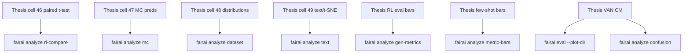

# Analysis & plots (Thesis SoT)

Extracted from `FAIRAI-Thesis.ipynb` cells **46–49** (ANALISYS), plus RL eval / few-shot chart helpers and VAN confusion matrices.

Requires optional extras:

```bash
pip install -e ".[viz]"          # matplotlib seaborn scipy pandas
pip install -e ".[viz,nlp,torch]"  # + nltk + sentence-transformers for text/t-SNE
```

## Map Thesis → CLI



| Command | Thesis origin | Outputs |
|---------|---------------|---------|
| `fairai analyze merge-mc` | cell 10 | flat `prompts` JSON |
| `fairai analyze rl-compare -m …` | cell 46 | JSON + mean±std bars |
| `fairai analyze mc -d …` | cell 47 | accuracy / CM / error-by-bias |
| `fairai analyze dataset -d …` | cell 48 | bias/label/length plots (6 PNGs) |
| `fairai analyze text -d …` | cell 49 | lexical, POS, VADER, TF-IDF, cosine, t-SNE |
| `fairai analyze gen-metrics -m …` | RL EVALUATION | perplexity / distinct / BLEU bars |
| `fairai analyze leakage -d …` | GAP-D4 | residual StereoSet-test overlaps; optional strict JSONL |
| `fairai analyze metric-bars -m …` | few-shot charts | grouped bars |
| `fairai analyze confusion -m …` | VAN / few-shot CM | PNG heatmap |
| `fairai eval … --plot-dir DIR` | `evaluate_model` | CM next to metrics JSON |
| `fairai infer --mc-samples 10` | cells 5/7 | MC dropout + dynamic gate |

Full cell matrix: [THESIS_PARITY.md](THESIS_PARITY.md).

## Example inputs

| File | Use |
|------|-----|
| `configs/analysis/rl_compare_example.json` | Paired Baseline/RL arrays (Thesis demo numbers) |
| `configs/analysis/gen_metrics_example.json` | Per-sample gen metrics |
| `configs/analysis/metric_bars_example.json` | Few-shot grouped series |

```bash
make analyze-smoke
# or
fairai analyze dataset -d artifacts/datasets/processed/van_minimal_24k.jsonl \
  -o artifacts/analysis/dataset --max-samples 2000
fairai analyze text -d artifacts/datasets/processed/van_minimal_24k.jsonl \
  -o artifacts/analysis/text --max-samples 500 --skip-tsne
```

## Code layout

| Layer | Module |
|-------|--------|
| Domain | `domain/analysis_stats.py` |
| Viz | `infrastructure/viz/{savefig,confusion,bars}.py` |
| Loaders | `infrastructure/analysis/mc_options.py` |
| Use-cases | `application/analyze_*.py` |
| CLI | `cli/analyze_cmd.py` |

Plots use the **Agg** backend (headless); files land under `artifacts/analysis/`.
