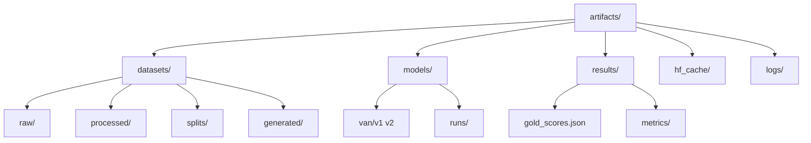
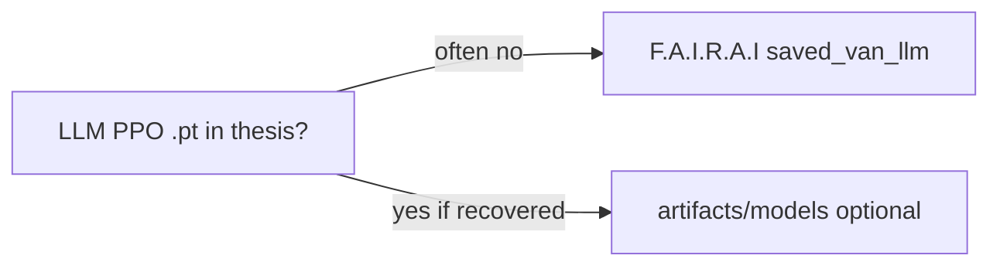

# Artifacts and results

From AS-IS `05_models_and_results.md`, Thesis outputs, and fairai import/Release.

## Layout



## Models

| Artifact | ≈Size | Notes |
|----------|------:|-------|
| `models/van/v2/final_model.pt` | 194 MB | Canonical classifier |
| `models/van/v2/best_model.pt` | 194 MB | Best val during final train |
| `models/van/v2/best_trial_params.json` | — | Optuna winner |
| `models/van/v2/best_threshold_params.json` | — | conf/margin/var/temp |
| `models/van/v1/*` | ~365 MB | Historical |
| `models/runs/<id>/*` | variable | Local retrain smoke |



## Eval / gold / metrics

| Artifact | Notes |
|----------|--------|
| `results/gold_scores.json` | Id → score (6369 inter + 6318 intra) |
| `configs/baselines/baseline_van_v2_icat.json` | Committed ICAT all-run |
| `results/metrics/icat_test.json` | Test-split ICAT |
| `results/metrics/icat_test_verify.json` | Paper Table A iCAT (StereoSet test) |
| `results/metrics/f1_test_leakfree_released.json` | Paper Table A F1 (leak-free select-options) |
| `results/metrics/optuna_fair_compare_agg.json` | Paper Table B target SoT (Optuna-equal HPO) |
| `results/metrics/rigorous_clean_compare_agg.json` | Interim fixed-HP matched ablations (WHM train iCAT) |
| `results/metrics/rigorous_ablation_compare_agg.json` | Historical Table B (WHM peeked test iCAT) |
| `optuna/optuna_fair_<fam>/` | Study DB + best_config.yaml per family |
| `results/metrics/select_options_test_f1.json` | Legacy F1 (~48% overlap) — not Table A |
| `results/metrics/llm_fewshot_van.json` | Few-shot smoke |
| `results/metrics/llm_ppo_smoke.json` | REINFORCE smoke |
| `results/metrics/compose_eval.json` | Compose eval profile |

## Provenance

```bash
fairai manifest --artifacts artifacts --verify
```

| File | Role |
|------|------|
| `artifacts/manifest.sha256.json` | Hash list |
| GitHub Release `v0.1.0` | Distributes `.pt` + splits zip |

Large files are **gitignored**. Publish steps: [RELEASE.md](RELEASE.md).

## Thesis-only logs (not required for CLI)

| Path | Role |
|------|------|
| `DEVELOP/log/adversarial_network.log` | Historical train log name (not ADV-only SoT) |
| `DEVELOP/log/ppo_training/*.tfevents.*` | PPO TensorBoard (Windows host in metadata) |
