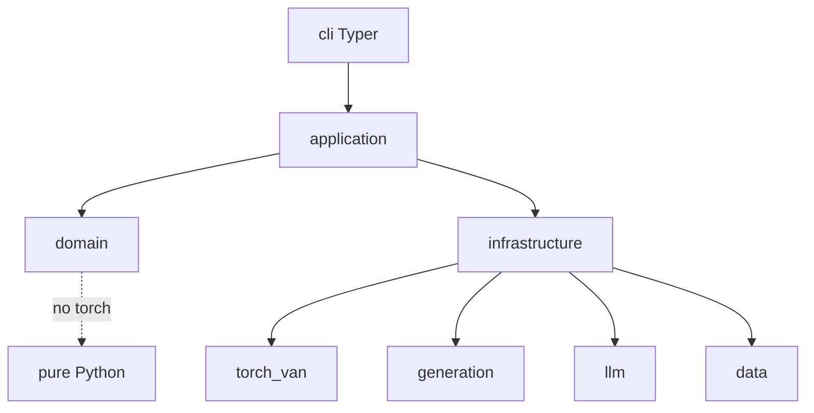
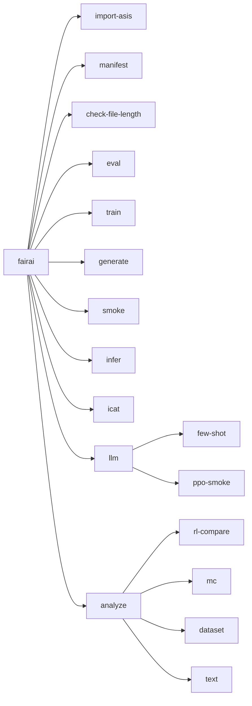

# Codebase map — `fairai/`

Multi-agent inventory (2026-10-22). Package under `src/fairai/`: **~56 Python files**, **~3400 LOC**, Clean Architecture.

## Authority (source of truth)

| Notebook | Role |
|----------|------|
| **`FAIRAI-Thesis.ipynb`** | VAN v2, ICAT, thresholds, train loop/losses, LLM few-shot/PPO |
| **`FAIRAI-GenerationDataset.ipynb`** | Multi-source dataset factory |

Non-SoT (legacy / sandbox): `FAIRAI-Adversarial Network.ipynb`, `FAIRAI.ipynb`, `TEST.ipynb`, `.ipynb_checkpoints/*`.

Cleanup plan: [SOT_CLEANUP_PLAN.md](SOT_CLEANUP_PLAN.md).

## Layer diagram

## Directory inventory (`src/fairai/`)

| Area | Path | ≈LOC | Role |
|------|------|-----:|------|
| CLI root | `cli/main.py` | 307 | import, manifest, eval, train, generate, smoke, infer |
| CLI ICAT | `cli/icat_cmd.py` | 90 | `fairai icat` |
| CLI LLM | `cli/llm_cmd.py` | 76 | `few-shot`, `ppo-smoke` |
| Domain | `domain/{labels,example,icat}.py` | ~120 | enums, records, ICAT math |
| Train | `application/train_van.py` + `torch_van/train_*` | ~350 | training use-case |
| ICAT | `application/evaluate_icat.py` | 222 | StereoSet LM/SS/iCAT |
| Infer/eval | `infer_texts.py`, `evaluate_classification.py` | ~200 | predict + F1 eval |
| Generate | `generate_dataset.py` + `generation/*` | ~480 | CrowS smoke factory |
| LLM | `few_shot_mc.py`, `ppo_smoke.py`, `llm/*` | ~410 | MC prompts + smoke RL |
| Import | `import_artifacts.py`, `asis_mapping.py` | ~220 | AS-IS → artifacts |
| VAN model | `torch_van/van_classifier.py` + `layers/*` | ~250 | MiniLM + BPL + residuals |
| Ops | `smoke.py`, `file_budget.py`, `hashing.py` | ~130 | CI / manifest |

Largest files (all &lt;500 LOC budget): `cli/main.py`, `evaluate_icat.py`, `train_van.py`.

## CLI surface

| Command | Primary modules |
|---------|-----------------|
| `import-asis` / `manifest` | `import_artifacts`, `asis_mapping`, `hashing` |
| `eval` / `infer` | `evaluate_classification`, `infer_texts`, `thresholds` |
| `train` | `train_van`, `train_loop`, `losses`, `optim_factory` |
| `icat` | `evaluate_icat`, `domain/icat`, `stereoset_flatten`, `parity` |
| `generate` | `generate_dataset`, `generation/*` |
| `llm few-shot` | `few_shot_mc`, `prompts`, `van_judge` |
| `llm ppo-smoke` | `ppo_smoke`, `ppo_env` |
| `analyze *` | `analyze_*`, `viz/*`, `domain/analysis_stats` |
| `smoke` | `smoke` + pytest + file budget |

## Configs

| File | Purpose |
|------|---------|
| `configs/models/van_v2.yaml` | Frozen Thesis Optuna winner |
| `configs/experiments/smoke_cpu.yaml` | Tiny CPU train smoke (`inherits`) |
| `configs/data/generate.yaml` | CrowS generation smoke |
| `configs/data/van_train.yaml` | Train data pointers |
| `configs/data/stereoset_eval.yaml` | ICAT splits pointer |
| `configs/baselines/baseline_van_v2_icat.json` | ICAT parity baseline |

## Tests (`tests/unit/` — 12 files)

| Test | Covers |
|------|--------|
| `test_van_load` | Strict load + forward shape |
| `test_icat_formula` / `test_stereoset_flatten` | ICAT + flatten |
| `test_losses` / `test_thresholds` | Focal/BiasAware + gates |
| `test_generation` | CrowS / leakage / schema |
| `test_llm_prompts` | Prompt parse |
| `test_config_merge` / `test_import_mapping` / `test_file_budget` / `test_smoke` / `test_labels` | Ops |

## Docker / Make

| Profile / target | Action |
|------------------|--------|
| `compose` `ci` | `fairai smoke` |
| `eval` / `eval-gpu` | `fairai eval` |
| `train` | smoke train |
| `gen` | `fairai generate` |
| `dev` | Jupyter (CUDA image) |
| `make train-smoke` / `generate-smoke` / `llm-*` | Local smokes |

## Feature ↔ notebook origin

| Feature | In code? | Origin under 2-notebook SoT |
|---------|----------|------------------------------|
| VAN load / infer / eval | yes | **Thesis** |
| ICAT + concat rule | yes | **Thesis** |
| Train + Focal/BiasAware | yes | **Thesis** (cell 1) |
| Threshold gates | yes | **Thesis** |
| Frozen `van_v2.yaml` | yes | **Thesis** Optuna output |
| Optuna live HPO | **no** | Thesis historical (GAP-G4) |
| CrowS + Thesis multi-source generate + leakage | yes | **GenerationDataset** |
| CoLA optional / Ollama rewrite | CoLA flag; Ollama **no** | GenerationDataset (GAP-E4 residual) |
| LLM few-shot / PPO smoke | yes (smoke) | **Thesis** |
| ANALISYS plots / text / CM / RL bars | yes (`fairai analyze`, `eval --plot-dir`) | **Thesis** cells 1, 15–17, 46–49 |
| MC dropout + dynamic gate | yes (`infer --mc-samples`) | **Thesis** cells 5/7 |
| MC merge pred→prompts | yes (`analyze merge-mc`) | **Thesis** cell 10 |
| Full 5× LLM PPO / Optuna live | smoke / frozen only | GAP-F5 / GAP-G4 |
| Adversarial / GRL / discriminator | **no code** | Non-SoT notebooks; unused Thesis imports |
| BiLSTM / no-BPL ablations | **no code** | Legacy `FAIRAI.ipynb` only |
| SB3 / v3 / v4 / N_TRIALS=1000 | **no code** | Sandbox `TEST.ipynb` only |

## Engineering cleanup (2026-10-24)

Shared `write_json` / `cli.json_io`, MC raw loader, `load_van_and_tokenizer`, unified neutral filter, prompt `_format_options_*`.  
SoT docs: GenDataset → Thesis only; `adversarial_enabled` removed from YAML.

## Related docs

- User guides: [README.md](README.md)
- Cleanup plan: [SOT_CLEANUP_PLAN.md](SOT_CLEANUP_PLAN.md)
- Verification: [verification/00_INDEX.md](verification/00_INDEX.md)
