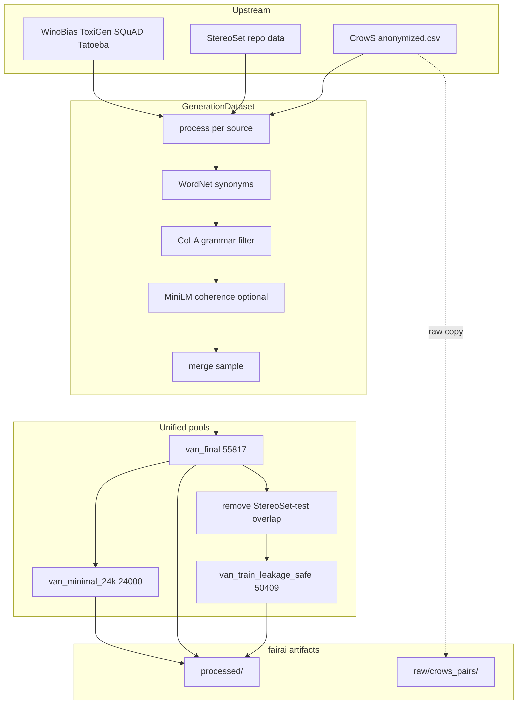
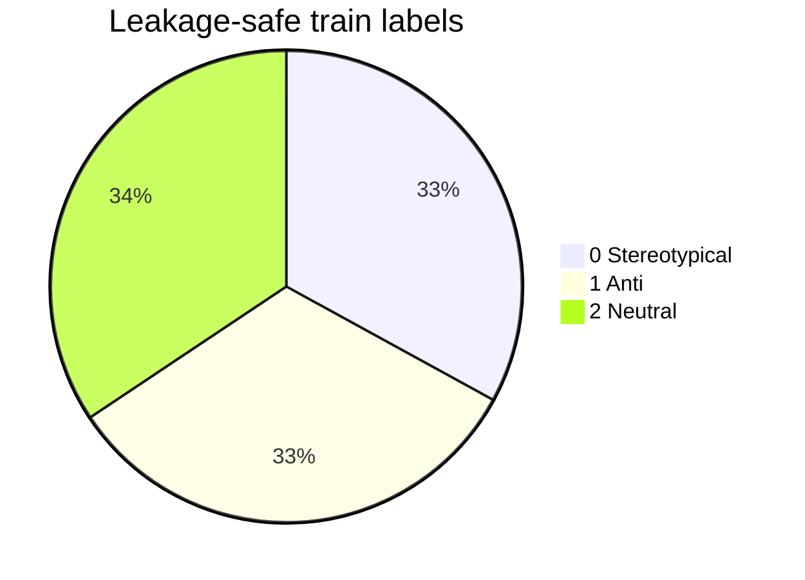
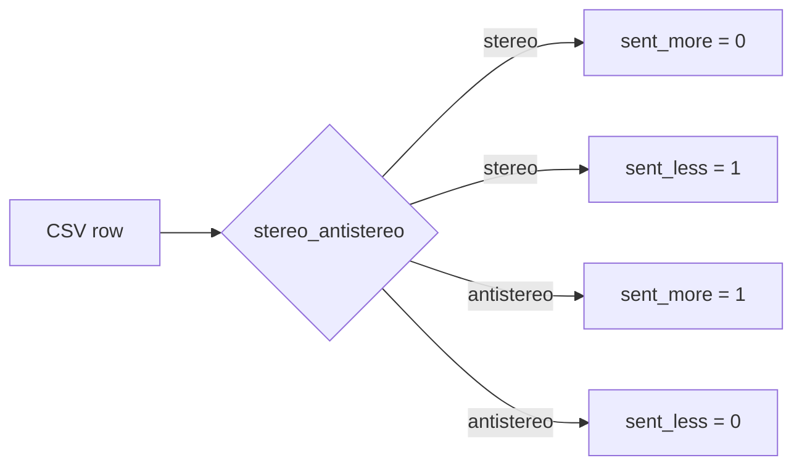
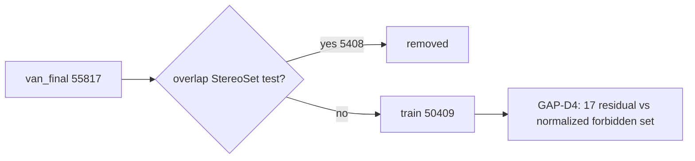

# Datasets

Content from `FAIRAI-GenerationDataset.ipynb`, Thesis train paths, and AS-IS `04_datasets_catalog.md`.

## Schema (VAN training JSONL)

```json
{
  "bias_type": "race|gender|profession|religion|null",
  "label": 0,
  "sentence": "…"
}
```

| Field | Type | Required | Notes |
|-------|------|----------|-------|
| `sentence` | string | yes | May contain `[SEP]` for inter-style rows |
| `label` | int ∈ {0,1,2} | yes | See [OVERVIEW.md](OVERVIEW.md) |
| `bias_type` | string \| null | no | `none`/empty → null in domain |
| `context` | string | no | Intermediate StereoSet only |
| `synonym_sentences` | list | no | GenerationDataset intermediates |

## Data flow



## Canonical fairai files

| Relative path under `artifacts/datasets/` | Rows | Role |
|-------------------------------------------|-----:|------|
| `processed/van_train_leakage_safe.jsonl` | **50409** | Thesis train SoT |
| `processed/van_final.jsonl` | **55817** | Full VAN pool |
| `processed/van_minimal_24k.jsonl` | **24000** | Balanced ≈8k×3 |
| `splits/stereoset/intersentence_{train,test}.json` | — | ICAT inter |
| `splits/stereoset/intrasentence_{train,test}.json` | — | ICAT intra |
| `processed/stereoset/stereoset_select_options_pred.json` | 1484/317/322 | LLM MC |
| `processed/stereoset/stereoset_select_options.json` | 2123 prompts | MC unsplit |
| `raw/crows_pairs/crows_pairs_anonymized.csv` | 1509 | CrowS upstream |
| `generated/*.jsonl` | variable | Regenerated only |

Also: `artifacts/results/gold_scores.json` (6369 inter + 6318 intra ids).

## Label distribution (leakage-safe train)

Verified Wave D (full file scan):

| Label | Meaning | Count | Share |
|------:|---------|------:|------:|
| 0 | Stereotypical | 16623 | 33.0% |
| 1 | Anti-stereotypical | 16466 | 32.7% |
| 2 | Neutral | 17320 | 34.4% |
| **Σ** | | **50409** | 100% |



## Upstream sources

| Source | Origin | Notebook treatment | Bias types |
|--------|--------|--------------------|------------|
| StereoSet | Upstream StereoSet release / local `data/` | Intra + inter; synonyms; combinations | race, gender, profession, religion |
| CrowS-Pairs | anonymized CSV | `sent_more` / `sent_less` → 0/1 | race-color, gender, … |
| WinoBias | HF `uclanlp/wino_bias` | type1/2 pro/anti | gender |
| ToxiGen | HF `toxigen/toxigen-data` | remap binary → {0,1,2} | toxicity (skew to 0) |
| SQuAD | HF | Neutral fillers | none → label 2 |
| Tatoeba | dump | Neutral fillers | null → label 2 |

### CrowS mapping



| `stereo_antistereo` | `sent_more` label | `sent_less` label |
|---------------------|------------------:|------------------:|
| `stereo` | 0 | 1 |
| `antistereo` | 1 | 0 |

## Leakage policy



| Fact | Value |
|------|------:|
| Removed for Thesis train | 5408 |
| Resulting train size | 50409 |
| Residual overlaps (fairai check) | 17 (0.034%) |
| Strict re-filter (optional) | 50392 → `generated/van_train_leakage_strict.jsonl` |
| Disposition | [GAP-D4](verification/GAPS.md) **closed** via `fairai analyze leakage` |

```bash
fairai analyze leakage \
  -d artifacts/datasets/processed/van_train_leakage_safe.jsonl \
  -o artifacts/analysis/leakage_audit.json \
  --out-strict artifacts/datasets/generated/van_train_leakage_strict.jsonl
```

## StereoSet flatten (ICAT inputs)

| Split | Concat `context`? | Format | n (train+test) |
|-------|-------------------|--------|---------------:|
| intersentence | **yes** | `context [SEP] sentence` | 6369 |
| intrasentence | **no** | sentence only | 6318 |
| **total** | | | **12687** |

## Canonical vs regenerated

| Kind | Path | Overwritten by `fairai generate`? |
|------|------|-----------------------------------|
| Canonical | `processed/van_*.jsonl` | **Never** |
| Regenerated | `generated/*.jsonl` | Yes (smoke outputs) |

Details: [GENERATE.md](GENERATE.md).
