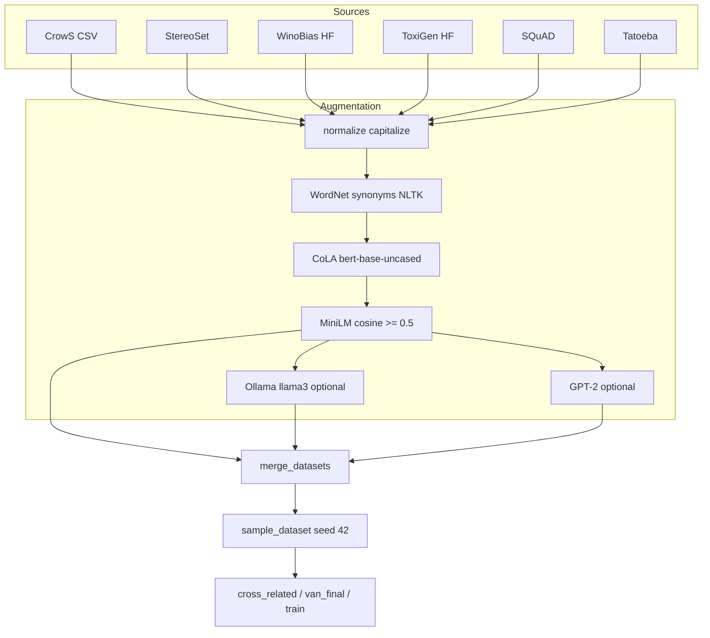
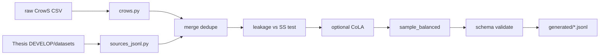

# Dataset generation

From `FAIRAI-GenerationDataset.ipynb` and `infrastructure/generation/`.

## Canonical vs regenerated

| Path | Role | `fairai generate` |
|------|------|-------------------|
| `artifacts/datasets/processed/van_*.jsonl` | **Canonical** SoT | never overwrites |
| `artifacts/datasets/generated/*.jsonl` | Regenerated tests | writes here |

## Full notebook pipeline



| Filter / tool | Setting (notebook) |
|---------------|--------------------|
| CoLA model | `textattack/bert-base-uncased-CoLA` |
| Embedding | `sentence-transformers/all-MiniLM-L6-v2` |
| Semantic threshold | cosine ≥ **0.5** |
| Ollama | `llama3:latest` @ `http://localhost:11434/api/generate` |
| Sample seed | 42 |
| Final pool size | ≈55817 |

### Key notebook helpers

| Function | Role |
|----------|------|
| `get_synonyms` / `generate_synonym_sentences` | WordNet expansion |
| `verify_grammar` | CoLA batch filter |
| `process_crows_pairs_csv` | CrowS → jsonl |
| `process_winobias_hf` / `process_toxigen_subset` | HF sources |
| `generate_combinations` | StereoSet combo expansion |
| `process_and_filter_dataset` | length + dedupe + SEP |
| `sample_dataset` | balanced / %-based sample |
| `merge_datasets` | concat jsonl streams |
| `generate_sentence_with_ollama` | LLM rewrite |

### CrowS mapping

| `stereo_antistereo` | more | less |
|---------------------|-----:|-----:|
| stereo | 0 | 1 |
| antistereo | 1 | 0 |

## fairai generate (implemented)



```bash
# CrowS-only smoke
fairai generate -c configs/data/generate.yaml
# → artifacts/datasets/generated/smoke_crows.jsonl (+ .meta.json)

# Multi-source from Thesis DEVELOP/datasets
fairai generate -c configs/data/generate_multisource.yaml
# → generated/smoke_multisource.jsonl
```

| Feature | Notebook | fairai |
|---------|:--------:|:------:|
| CrowS → JSONL | yes | **yes** |
| WinoBias / ToxiGen / SQuAD / Tatoeba / StereoSet pools | yes | **yes** (`thesis_datasets_root`) |
| Leakage filter | thesis train | **yes** |
| Schema validate | informal | **yes** |
| WordNet `--synonyms` | yes | optional |
| CoLA filter | yes | optional (`filter_cola: true`) |
| Ollama / MiniLM semantic rewrite | yes | **GAP-E4 residual** |

Compose: `docker compose --profile gen run --rm gen`.

## Full rebuild (optional)

1. Set `generate.thesis_datasets_root` to `TESI MAGISTRALE/DEVELOP/datasets` (or mirror under `artifacts/datasets/raw/`).  
2. `fairai generate -c configs/data/generate_multisource.yaml --sources winobias,toxigen,squad,tatoeba,stereoset,crows`  
3. Optional: `filter_cola: true` (downloads CoLA). Ollama rewrite remains notebook-only.  
4. Keep imported `van_train_leakage_safe.jsonl` for parity unless re-deriving train intentionally.  
