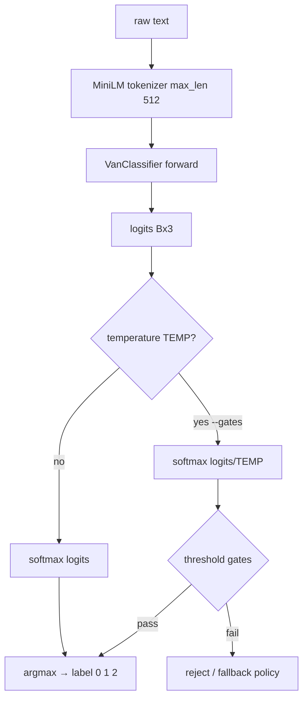
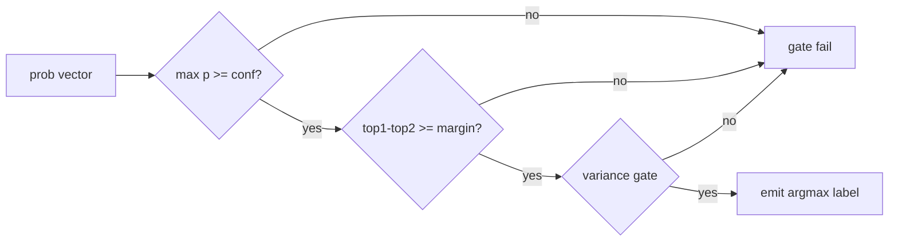
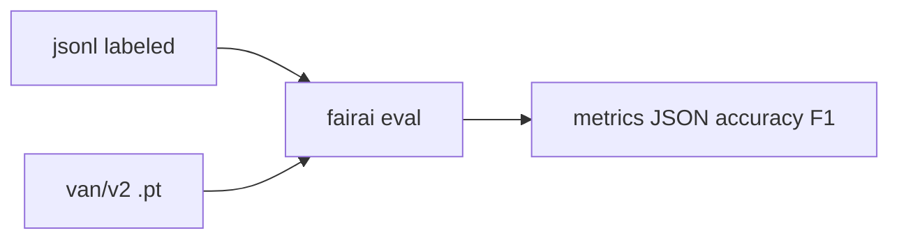
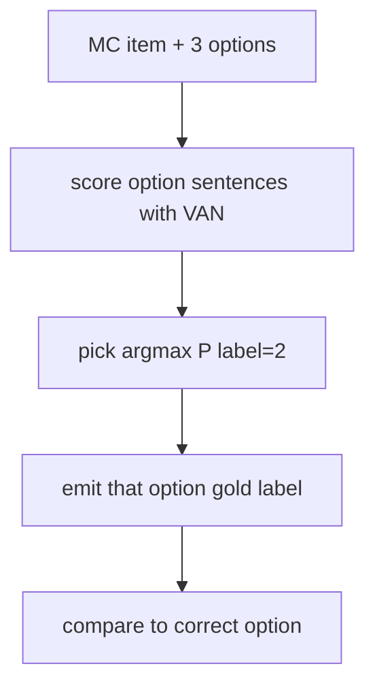

# Inference and threshold gates

From **`FAIRAI-Thesis.ipynb`** (PROMPT TEST / Optuna threshold section).

## Predict flow



```bash
fairai infer -t "The nurse was caring." --device cpu
fairai infer -t "…" --gates
# Thesis PROMPT TEST (cells 5/7): MC dropout + dynamic_threshold = conf - 0.5*max_var
fairai infer -t "…" --mc-samples 10
```

| Step | Module |
|------|--------|
| Load ckpt + YAML | `torch_van/checkpoint.py` |
| Forward | `van_classifier.py` |
| Gates (single-pass) | `thresholds.predict_from_logits` |
| MC dropout + dynamic gate | `thresholds.predict_mc_dropout` |

On MC abstention Thesis returned `None`; CLI sets `abstained=true` and label **Neutral**, and includes `prob_variance`.  
Gate uses variance of the **winning** class (`var[argmax]`), matching Thesis `classify_text`.  
`bias_warning=true` when the accepted label is Stereotypical or Anti-stereotypical (Thesis console warning).

PROMPT TEST REPL (`input()` loop) → use CLI:

```bash
fairai infer -t "…" --mc-samples 10
# or batch from file:
fairai infer -f prompts.txt --mc-samples 10
```

Label an entire StereoSet MC file (Thesis `update_dataset_with_predictions`):

```bash
fairai analyze label-mc \
  -i artifacts/datasets/processed/stereoset/stereoset_select_options.json \
  -o artifacts/datasets/processed/stereoset/stereoset_select_options_pred.json \
  --mc-samples 10
```

Threshold Optuna (`n_trials=1000`, objective=`accuracy×coverage`) is **frozen** in `van_v2.yaml` / `best_threshold_params.json` (GAP-G4).

## Threshold parameters (VAN v2)

From `best_threshold_params.json` / `configs/models/van_v2.yaml`:

| YAML key | Thesis name | Value | Role |
|----------|-------------|------:|------|
| `conf` | CONF_THRESHOLD | ≈0.346 | Min max-probability to accept |
| `margin` | MARGIN_THRESHOLD | ≈0.018 | Min top1−top2 gap |
| `var` | VAR_THRESHOLD | ≈0.494 | Variance-related gate on probs |
| `temp` | TEMP | ≈0.181 | Softmax temperature (<1 sharpens) |



Without `--gates`, fairai uses plain argmax (smoke / default eval).

Thesis tunes thresholds with Optuna vs classification / ICAT objectives.

## Classification eval



```bash
fairai eval --max-samples 512 --device cpu \
  --out artifacts/results/metrics/eval.json
```

| Flag | Default |
|------|---------|
| `--dataset` | `van_minimal_24k.jsonl` |
| `--checkpoint` | `artifacts/models/van/v2/final_model.pt` |
| `--max-samples` | 512 |
| `--gates` | off |

## MC “neutral judge”



Aligns with Thesis few-shot teaching (“prefer Label 2”). Full prompt path: [LLM.md](LLM.md).
