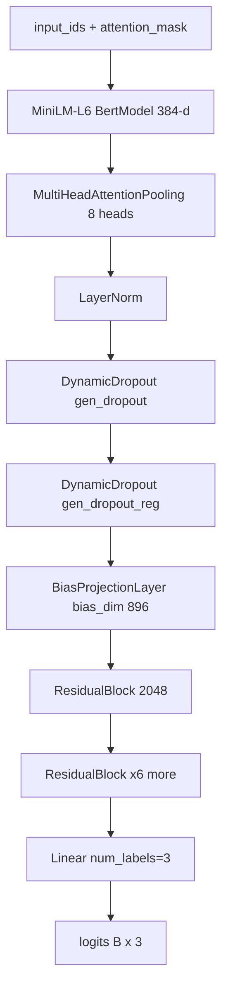
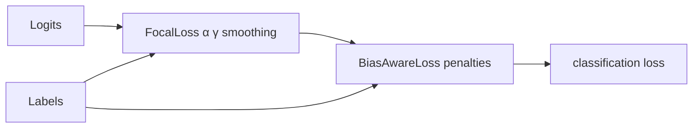
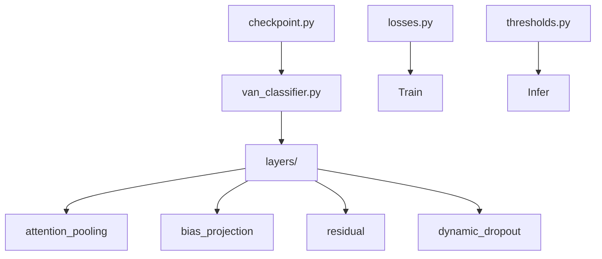

# VAN model (SingleSentenceModel)

From **`FAIRAI-Thesis.ipynb`** (SoT). Code: `src/fairai/infrastructure/torch_van/`.

> Legacy: GRL / discriminator experiments lived in non-SoT notebooks; **not** in fairai v2.

## Role

Three-way classifier over a sentence (optionally `context [SEP] continuation` for intersentence StereoSet).

## Architecture diagram (VAN v2)

## Tensor shapes

| Stage | Shape |
|-------|-------|
| `input_ids` | `[B, L]` L≤512 |
| Encoder hidden | `[B, L, 384]` |
| Pooled | `[B, 384]` |
| After residual stack | `[B, 2048]` |
| Logits | `[B, 3]` |

## Ablation switch

`architecture.use_bias_projection: false` replaces `BiasProjectionLayer` with `nn.Identity` (baseline CE / −BPL ablation). Checkpoint keys omit `bias_layer.projection.*`.

## Losses

| Component | Formula / rule | v2 defaults |
|-----------|----------------|-------------|
| Focal | \(\alpha_t (1-p_t)^\gamma \cdot \mathrm{CE}\) | α≈1.475, γ≈2.141, smoothing≈0.082 |
| BiasAware | focal × penalty[label] × optional class_weight | see table below |

| Class | Penalty (v2) |
|------:|-------------:|
| 0 stereotype | ≈2.675 |
| 1 anti | ≈2.129 |
| 2 neutral | ≈1.068 |

## Frozen v2 hyperparameters

Source: `best_trial_params.json` ↔ `configs/models/van_v2.yaml` (Wave B: **23/23** match).

### Architecture

| Param | Value |
|-------|------:|
| `gen_num_layers` | 7 |
| `gen_hidden_size` | 2048 |
| `gen_dropout` | ≈0.1006 |
| `gen_dropout_reg` | ≈0.6967 |
| `multihead_num_heads` | 8 |
| `att_dropout` | ≈0.154 |
| `bias_dim` | 896 |
| `bias_num_layers` | 1 |
| `bias_dropout` | ≈0.136 |
| `bias_lambda` | ≈1.421 |

### Optim / train

| Param | Value | Wired in fairai? |
|-------|------:|:---:|
| `learning_rate` | ≈7.04e-6 | yes |
| `lr_multiplier` | ≈8.41 | **no** (provenance only) |
| `weight_decay` | ≈2.5e-4 | yes |
| `scheduler` | cosine | yes |
| `warmup_pct` | ≈0.290 | yes |
| `clip_factor` | ≈0.433 | yes |
| `ema_decay` | ≈0.288 | **no** (provenance only) |
| `batch_size` | 64 | yes |
| `grad_accum_steps` | 8 | yes |
| `epochs` | 100 | yes |
| `patience` | 5 | yes |
| `seed` | 42 | yes |
| `amp` | true (CUDA) | yes |

`lr_multiplier` / `ema_decay` remain in YAML from the Optuna trial record; `optim_factory` / `train_van` use a single AdamW `learning_rate` and no EMA.

## Checkpoints

| Version | ≈Size | Path |
|---------|------:|------|
| **v2** (canonical) | 194 MB | `artifacts/models/van/v2/final_model.pt` |
| v2 best | 194 MB | `…/best_model.pt` |
| v1 | 365 MB | `artifacts/models/van/v1/` |

| Sidecar JSON | Purpose |
|--------------|---------|
| `best_trial_params.json` | Optuna architecture / loss / optim |
| `best_threshold_params.json` | conf / margin / var / temp |

**Notebook pitfall:** cells may write `saved_models/v1` — on disk use `saved_models/van/v{1,2}/`.

## Code map

| Concern | Module |
|---------|--------|
| Model | `torch_van/van_classifier.py` |
| Layers | `torch_van/layers/*` |
| Load | `torch_van/checkpoint.py` |
| Loss | `torch_van/losses.py` |
| Thresholds | `torch_van/thresholds.py` |
| Train loop | `torch_van/train_loop.py` |
