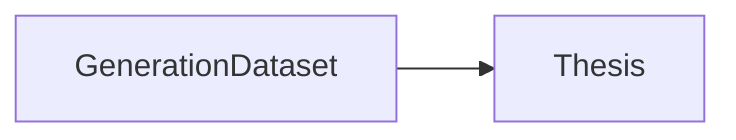
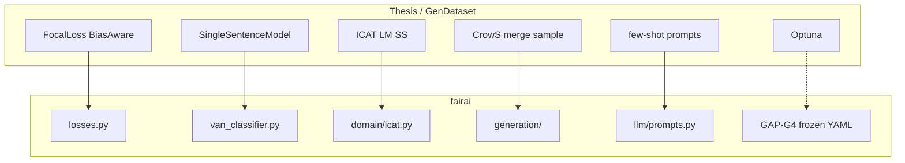

# Thesis notebooks → fairai

**Source of truth (only):**

1. `FAIRAI-GenerationDataset.ipynb` — multi-source dataset factory  
2. `FAIRAI-Thesis.ipynb` — VAN train / ICAT / thresholds / LLM / ANALISYS  

**Notebook CWD:** `TESI MAGISTRALE/DEVELOP/`.

## Canonical execution order

| # | Notebook | Role |
|---|----------|------|
| 1 | `FAIRAI-GenerationDataset.ipynb` | Multi-source factory |
| 2 | `FAIRAI-Thesis.ipynb` | VAN v2 + ICAT + LLM + analysis |

## Catalog (SoT)

| Notebook | ~Cells | Role | fairai home |
|----------|-------:|------|-------------|
| `FAIRAI-GenerationDataset.ipynb` | 48 | Synonyms, CoLA, Ollama, merge | `generate` · [GENERATE.md](GENERATE.md) |
| `FAIRAI-Thesis.ipynb` | 51 | VAN train/eval, ICAT, MC, PPO/few-shot, ANALISYS | `train` / `icat` / `infer` / `llm` / `analyze` |

## Concern → module map

| Notebook concern | fairai |
|------------------|--------|
| `FocalLoss`, `BiasAwareLoss` | `torch_van/losses.py` |
| `SingleSentenceModel`, BPL, pooling | `van_classifier.py`, `layers/` |
| `compute_icat_score`, LM/SS | `domain/icat.py`, `evaluate_icat.py` |
| CrowS / merge / sample | `infrastructure/generation/` |
| `build_few_shot_prompt`, `parse_prediction` | `llm/prompts.py` |
| ANALISYS plots / CM / text / RL bars | `fairai analyze` · [ANALYSIS.md](ANALYSIS.md) |
| Optuna study | **not ported** — frozen YAML (GAP-G4) |

## Path drift

| Notebook path | On disk / fairai |
|---------------|------------------|
| `data/cross_related_dataset_van.jsonl` | `artifacts/.../van_train_leakage_safe.jsonl` |
| `datasets/cross_related_dataset_van_final.jsonl` | `artifacts/.../van_final.jsonl` |
| `saved_models/van/v2` | `artifacts/models/van/v2` |

## Legacy (non-SoT)

Do **not** treat as authority for fairai:

| Notebook | Why out |
|----------|---------|
| `FAIRAI-Adversarial Network.ipynb` | Historical ADV train; VAN/ICAT SoT is Thesis |
| `FAIRAI.ipynb` | Ablations (BiLSTM / no-BPL) — not shipped v2 |
| `TEST.ipynb` | Sandbox (v3/v4, SB3, N_TRIALS=1000) |
| `.ipynb_checkpoints/*` | Out of pipeline |

See [SOT_CLEANUP_PLAN.md](SOT_CLEANUP_PLAN.md).
