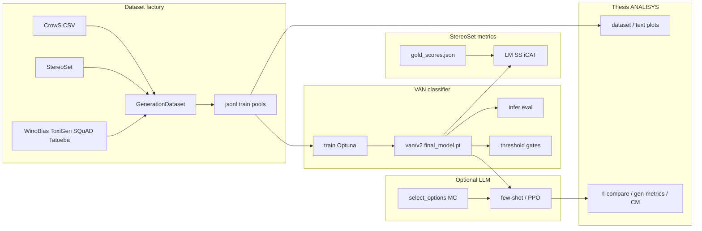
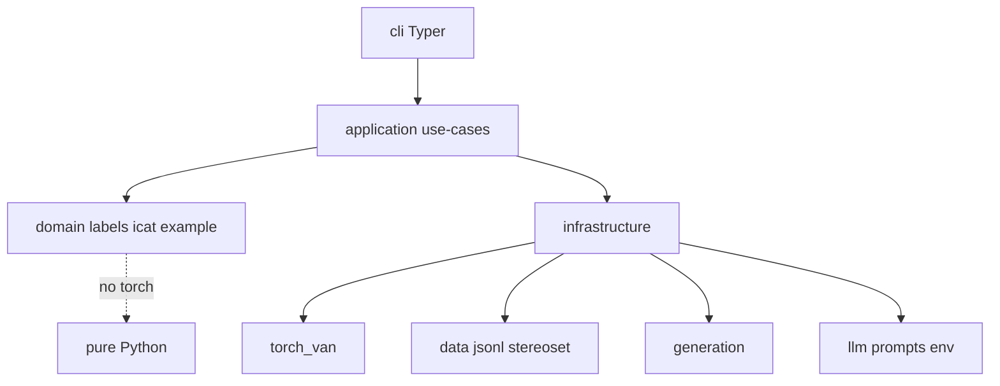
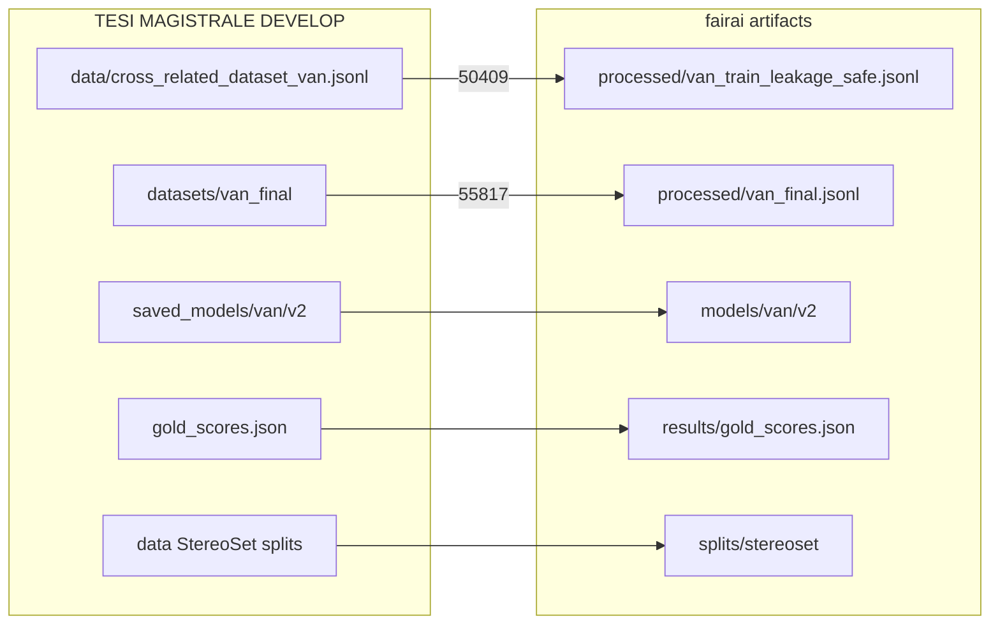

# Overview — FAIRAI / VAN

FAIRAI is a research pipeline for **stereotype / bias classification** in English text, rewritten from the master’s thesis notebooks into a Clean Architecture Python package (`fairai`).

## End-to-end pipeline



## Stage map (notebook → CLI)

| Stage | SoT notebook | fairai CLI | Doc |
|-------|--------------|------------|-----|
| Dataset factory | `FAIRAI-GenerationDataset.ipynb` | `fairai generate` | [GENERATE.md](GENERATE.md) |
| VAN train / hparams | `FAIRAI-Thesis.ipynb` | `fairai train` | [TRAIN.md](TRAIN.md) |
| Architecture | Thesis | load via checkpoint | [MODEL_VAN.md](MODEL_VAN.md) |
| ICAT + gold | Thesis | `fairai icat` | [EVAL_ICAT.md](EVAL_ICAT.md) |
| Infer / thresholds | Thesis | `fairai infer`, `eval` | [INFERENCE.md](INFERENCE.md) |
| LLM MC / PPO | Thesis | `fairai llm …` | [LLM.md](LLM.md) |
| Plots / text analysis | Thesis cells 46–49 (+ RL/CM) | `fairai analyze …` | [ANALYSIS.md](ANALYSIS.md) |

## Package layers (Clean Architecture)



| Layer | Responsibility | Example modules |
|-------|----------------|-----------------|
| `domain/` | Labels, ICAT math, `Example` | `labels.py`, `icat.py` |
| `application/` | Use-cases | `train_van`, `evaluate_icat`, `generate_dataset` |
| `infrastructure/` | I/O, torch, HF | `torch_van/`, `generation/`, `llm/` |
| `cli/` | Typer entrypoints | `main.py`, `icat_cmd.py`, `llm_cmd.py` |

## Labels

| `label` | Name | Typical use |
|--------:|------|-------------|
| 0 | Stereotypical | CrowS `sent_more` when `stereo`; StereoSet stereotype option |
| 1 | Anti-stereotypical | CrowS `sent_less` when `stereo`; anti option |
| 2 | Neutral | Unrelated / filler / preferred few-shot answer |

## Backbone and checkpoint

| Item | Value |
|------|-------|
| Encoder | `sentence-transformers/all-MiniLM-L6-v2` |
| Hidden size | 384 |
| `max_len` | 512 |
| Shipped checkpoint | **VAN v2** → `artifacts/models/van/v2/final_model.pt` |
| ICAT baseline (all) | avg_icat **96.0973** (n=12687) |

## Artifact mapping (thesis → fairai)



| Thesis (`DEVELOP/`) | fairai | Rows / note |
|---------------------|--------|-------------|
| `data/cross_related_dataset_van.jsonl` | `datasets/processed/van_train_leakage_safe.jsonl` | 50409 leakage-safe |
| `datasets/cross_related_dataset_van_final.jsonl` | `…/van_final.jsonl` | 55817 |
| `datasets/…_minimal_dataset.jsonl` | `…/van_minimal_24k.jsonl` | 24000 |
| `saved_models/van/v2/*` | `models/van/v2/` | `.pt` + JSON params |
| `gold_scores.json` | `results/gold_scores.json` | ICAT gold |
| `data/*sentence_*.json` | `datasets/splits/stereoset/` | inter/intra train/test |

```bash
make import-asis ASIS_ROOT="../TESI MAGISTRALE"
```

## Related docs

| Doc | Purpose |
|-----|---------|
| [NOTEBOOKS.md](NOTEBOOKS.md) | Notebook → module map |
| [verification/00_INDEX.md](verification/00_INDEX.md) | Anti-regression scorecard |
| `TESI MAGISTRALE/00_ASIS_FOR_REWRITE/` | Deep AS-IS inventory |
| `…/TOBE/` | Design decisions / roadmap |
