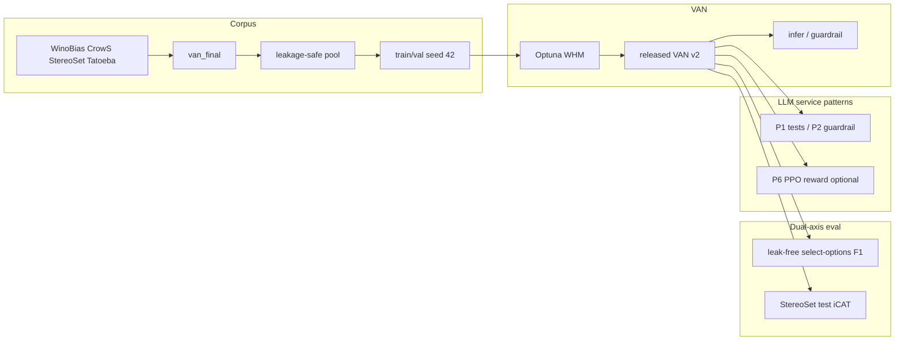
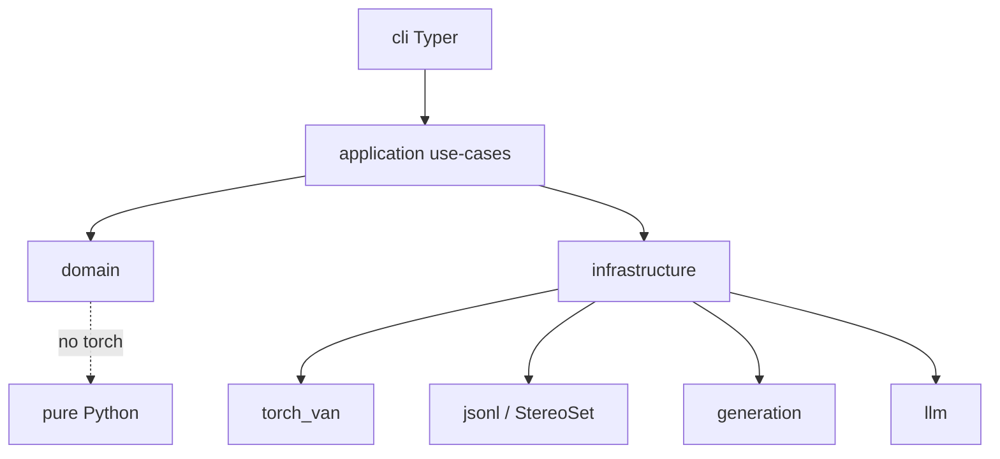

# Overview — FAIRAI / VAN

FAIRAI is a research package for **stereotype / bias classification** in English text, developed by **Danilo Giovannico (University of Salento)**. It ships a unified three-label corpus pipeline, a dual-axis evaluation protocol (detection macro-F1 + preference fairness via adapted StereoSet iCAT), and the compact **VAN** classifier used in the IEEE Software draft under `paper/`.

## End-to-end pipeline

## Package layers (Clean Architecture)

| Layer | Responsibility | Examples |
|-------|----------------|----------|
| `domain/` | Labels, ICAT math, Optuna search spaces | `labels.py`, `icat.py`, `optuna_space.py` |
| `application/` | Use-cases | `train_van`, `run_optuna_hpo`, `evaluate_icat`, `generate_dataset` |
| `infrastructure/` | I/O, torch, HF, Docker hooks | `torch_van/`, `generation/`, `llm/` |
| `cli/` | Typer entrypoints | `main.py`, `experiment_cmd.py`, `icat_cmd.py` |

## Labels

| `label` | Name | Meaning |
|--------:|------|---------|
| 0 | Stereotypical | Group–trait association in the conventional direction |
| 1 | Counter-stereotypical | Reversed association (still a stereotype) |
| 2 | No association / neutral | Fluent text without group–trait link |

## Dual-axis metrics

| Axis | Question | Primary resource |
|------|----------|------------------|
| Detection (macro-F1) | Are labels correct? | Leak-free StereoSet select-options with **neutral** label 2 |
| Preference (iCAT) | Are stereo / anti treated alike? | Official StereoSet test under **adapted** classifier rules |

F1 and iCAT intentionally use related but non-identical resources. Details: [EVAL_ICAT.md](EVAL_ICAT.md), [REPRODUCE_PAPER.md](REPRODUCE_PAPER.md).

## Optuna model selection

Trials maximize a weighted harmonic mean (WHM) of validation macro-F1 and StereoSet-**train** iCAT (`f1_weight ≈ 1.88`), with TPE + MedianPruner. The released VAN checkpoint comes from the historical product search (`configs/models/van_v2.yaml`). Equal-budget and van-policy baseline studies live under `artifacts/optuna/` and `configs/experiments/`.

## Stage → CLI

| Stage | CLI | Doc |
|-------|-----|-----|
| Dataset factory | `fairai generate` | [GENERATE.md](GENERATE.md) |
| Train | `fairai train` | [TRAIN.md](TRAIN.md) |
| Optuna HPO | `fairai experiment optuna` | [TRAIN.md](TRAIN.md) |
| Suite / Table B | `fairai experiment suite` | [REPRODUCE_PAPER.md](REPRODUCE_PAPER.md) |
| ICAT | `fairai icat` | [EVAL_ICAT.md](EVAL_ICAT.md) |
| Infer | `fairai infer` / `eval` | [INFERENCE.md](INFERENCE.md) |
| LLM patterns | `fairai llm …` | [LLM.md](LLM.md) |
| Audits | `fairai analyze …` | [ANALYSIS.md](ANALYSIS.md) |

## Artifact map (high level)

| Path | In git? | Role |
|------|---------|------|
| `configs/models/van_v2.yaml` | yes | Released hparams |
| `configs/provenance/` | yes | Paper traceability packs |
| `artifacts/results/metrics/*.json` | yes | Eval aggregates |
| `artifacts/optuna/*/best_*`, `study.db` | yes | HPO provenance |
| `artifacts/datasets/**` | no | Local data |
| `artifacts/models/**/*.pt` | no | Local weights |

## Related reading

- [DATASETS.md](DATASETS.md) — corpus sizes and leakage  
- [MODEL_VAN.md](MODEL_VAN.md) — architecture  
- [ARTIFACTS_AND_RESULTS.md](ARTIFACTS_AND_RESULTS.md) — full tree  
- [verification/00_INDEX.md](verification/00_INDEX.md) — parity waves  
