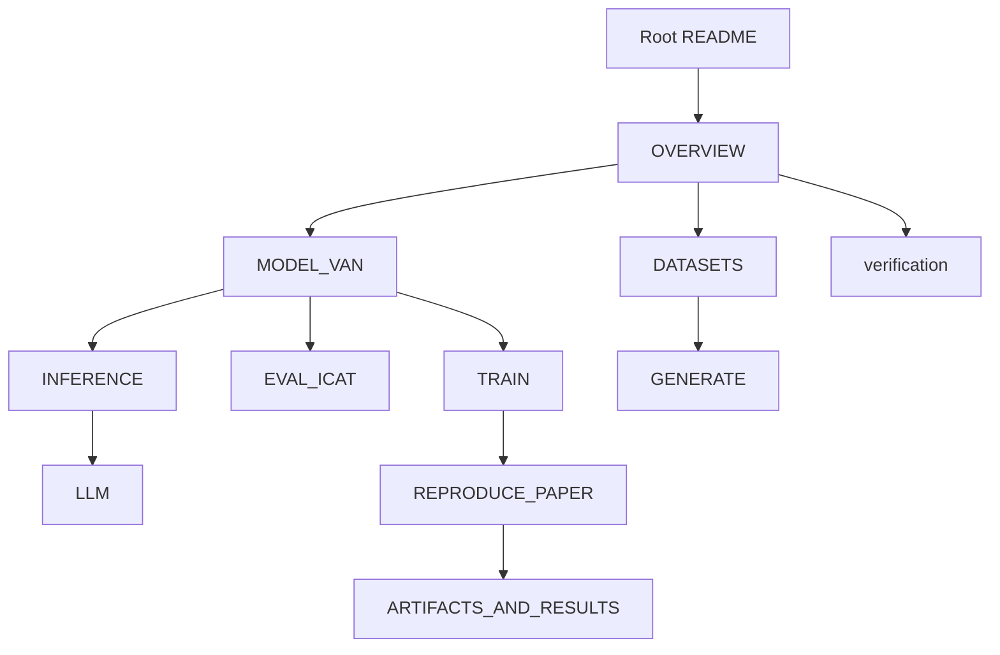

# FAIRAI documentation

Complete documentation for the **FAIRAI / VAN** package: stereotype detection corpus, dual-axis metrics (macro-F1 + adapted StereoSet iCAT), Optuna HPO, and IEEE Software paper reproduction.

**Copyright:** Danilo Giovannico — University of Salento. See root [LICENSE](../LICENSE) (all rights reserved; not MIT).

---

## Start here

1. Root [README.md](../README.md) — install, quick start, paper numbers  
2. [OVERVIEW.md](OVERVIEW.md) — end-to-end pipeline and package layers  
3. [REPRODUCE_PAPER.md](REPRODUCE_PAPER.md) — Table A / Table B protocol  
4. [TRAIN.md](TRAIN.md) — training + Optuna (fair compare & van-policy)  
5. [verification/00_INDEX.md](verification/00_INDEX.md) — anti-regression evidence  



---

## Guides

| Doc | Contents |
|-----|----------|
| [OVERVIEW.md](OVERVIEW.md) | Pipeline, labels 0/1/2, Clean Architecture layers |
| [CODEBASE_MAP.md](CODEBASE_MAP.md) | Module inventory and CLI surface |
| [DATASETS.md](DATASETS.md) | `van_final` → leakage-safe pool → splits; StereoSet hold-out |
| [MODEL_VAN.md](MODEL_VAN.md) | Encoder, BPL, residual stack, frozen v2 YAML |
| [TRAIN.md](TRAIN.md) | `fairai train`, WHM selection, Optuna TPE/MedianPruner |
| [EVAL_ICAT.md](EVAL_ICAT.md) | Adapted LM/SS/iCAT formulas and concat rules |
| [INFERENCE.md](INFERENCE.md) | Batch predict, thresholds, MC dropout abstention |
| [GENERATE.md](GENERATE.md) | Multi-source corpus generation |
| [LLM.md](LLM.md) | Few-shot MC and PPO reward smoke |
| [ANALYSIS.md](ANALYSIS.md) | Dataset / RL / CM analysis commands |
| [ARTIFACTS_AND_RESULTS.md](ARTIFACTS_AND_RESULTS.md) | What is in git vs local-only |
| [REPRODUCE_PAPER.md](REPRODUCE_PAPER.md) | Leak-free F1 + StereoSet-test iCAT suites |
| [RELEASE.md](RELEASE.md) | Release checklist |
| [THESIS_PARITY.md](THESIS_PARITY.md) | Historical notebook ↔ package coverage |
| [NOTEBOOKS.md](NOTEBOOKS.md) | Notebook catalog (legacy SoT map) |
| [SOT_CLEANUP_PLAN.md](SOT_CLEANUP_PLAN.md) | Cleanup of non-SoT surfaces |
| [verification/00_INDEX.md](verification/00_INDEX.md) | Wave A–G scorecard |
| [verification/GAPS.md](verification/GAPS.md) | Closed / open gaps |

---

## Paper artifacts (tracked)

| Artifact | Role |
|----------|------|
| `configs/models/van_v2.yaml` | Released VAN hyperparameters |
| `configs/experiments/optuna_*_best.yaml` | Optuna winners for baselines |
| `configs/provenance/` | Table B / van-policy manifests |
| `artifacts/optuna/*/best_*.yaml|json` + `study_summary.json` + `study.db` | HPO provenance |
| `artifacts/results/metrics/*.json` | Eval aggregates (incl. `optuna_product_compare_agg.json`) |
| `paper/ieee_software_stereotypes.tex` | IEEE Software draft |

Datasets and `.pt` checkpoints stay **local** (`.gitignore`). Import with `make import-asis` or regenerate via `fairai generate`.

---

## CLI cheat sheet

```bash
fairai train -c configs/models/van_v2.yaml
fairai icat --subset test
fairai experiment suite -c configs/experiments/suite_optuna_product.yaml --skip-train
fairai experiment optuna -f ce -c configs/experiments/optuna_vanpolicy_base.yaml --n-trials 100
fairai analyze f1-split
fairai analyze leakage
fairai llm few-shot --max-examples 64
```

Docker GPU helpers: `make optuna-vanpolicy-ce`, `make optuna-vanpolicy-nobpl`, `Makefile` Optuna / suite targets.

---

## License reminder

Software copyright **Danilo Giovannico, University of Salento** — all rights reserved ([LICENSE](../LICENSE)).  
Third-party data/model terms: [NOTICE.md](../NOTICE.md).
