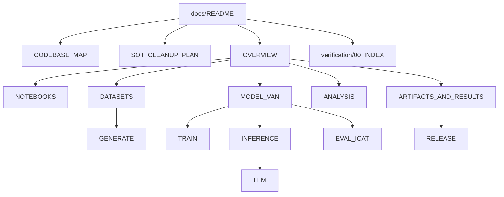

# Documentation index

**Source of truth (only):** `FAIRAI-Thesis.ipynb` + `FAIRAI-GenerationDataset.ipynb`.  
Legacy notebooks (`Adversarial Network`, `FAIRAI`, `TEST`) are **not** SoT — see [SOT_CLEANUP_PLAN.md](SOT_CLEANUP_PLAN.md).

## Doc map

## Guides

| Doc | Contents | Diagrams |
|-----|----------|----------|
| [CODEBASE_MAP.md](CODEBASE_MAP.md) | Package inventory, CLI, KEEP/TRIM matrix | layers, CLI |
| [SOT_CLEANUP_PLAN.md](SOT_CLEANUP_PLAN.md) | Remove non-SoT surface (docs + dead YAML) | phases |
| [OVERVIEW.md](OVERVIEW.md) | Pipeline, layers, labels, artifact map | end-to-end, Clean Architecture |
| [ANALYSIS.md](ANALYSIS.md) | Thesis plots / ANALISYS → `fairai analyze` | cell→CLI map |
| [THESIS_PARITY.md](THESIS_PARITY.md) | Cell-by-cell Thesis coverage (text/images/code) | parity table |
| [NOTEBOOKS.md](NOTEBOOKS.md) | Notebook catalog → modules | execution order, concern map |
| [DATASETS.md](DATASETS.md) | Schemas, counts, leakage, CrowS | data flow, pie labels |
| [MODEL_VAN.md](MODEL_VAN.md) | Architecture, losses, v2 hparams | model stack, loss, code map |
| [TRAIN.md](TRAIN.md) | Train loop, Optuna gap, CLI | train flowchart, Optuna |
| [EVAL_ICAT.md](EVAL_ICAT.md) | LM/SS/iCAT, concat, baselines | metric flow, concat rule |
| [INFERENCE.md](INFERENCE.md) | Predict + threshold gates | infer + gate decision |
| [GENERATE.md](GENERATE.md) | GenerationDataset + smoke | full factory + smoke path |
| [LLM.md](LLM.md) | Few-shot / PPO | prompts, VAN judge, PPO |
| [ARTIFACTS_AND_RESULTS.md](ARTIFACTS_AND_RESULTS.md) | Checkpoints, gold, Release | tree layout |
| [RELEASE.md](RELEASE.md) | Publish checklist | — |
| [verification/00_INDEX.md](verification/00_INDEX.md) | Anti-regression scorecard | wave DAG in plan |

## Reading order (suggested)

1. [CODEBASE_MAP.md](CODEBASE_MAP.md) → [SOT_CLEANUP_PLAN.md](SOT_CLEANUP_PLAN.md)  
2. [OVERVIEW.md](OVERVIEW.md) → [NOTEBOOKS.md](NOTEBOOKS.md)  
3. [DATASETS.md](DATASETS.md) → [MODEL_VAN.md](MODEL_VAN.md)  
4. [TRAIN.md](TRAIN.md) / [EVAL_ICAT.md](EVAL_ICAT.md) / [INFERENCE.md](INFERENCE.md)  
5. [GENERATE.md](GENERATE.md) → [LLM.md](LLM.md) → [ANALYSIS.md](ANALYSIS.md)  
6. [verification/00_INDEX.md](verification/00_INDEX.md) for parity evidence  

## External design packs

| Link | Content |
|------|---------|
| [AS-IS rewrite pack](../../TESI%20MAGISTRALE/00_ASIS_FOR_REWRITE/) | Deep inventory |
| [TO-BE design](../../TESI%20MAGISTRALE/00_ASIS_FOR_REWRITE/TOBE/) | Architecture decisions, roadmap |
| [NOTICE](../NOTICE.md) | Dataset citations + ethical use |
| [CONTRIBUTING](../CONTRIBUTING.md) | Dev setup and PR checks |

Local symlink (optional): `docs/ASIS_SOURCE` → thesis `00_ASIS_FOR_REWRITE`.
