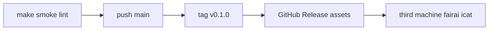

# Publication checklist

**Copyright:** Danilo Giovannico, University of Salento — [LICENSE](../LICENSE) (all rights reserved; not MIT).

## Flow



## Before push

| # | Check |
|---|--------|
| 1 | Remotes: `origin` = `softengunisalento/van_bias_aware` (and/or `fairai`) |
| 2 | `.gitignore` keeps datasets/weights local; metrics + Optuna summaries tracked |
| 3 | `pytest -q` / `make smoke` green where hardware allows |
| 4 | `LICENSE` is proprietary UniSalento / Giovannico (no MIT) |
| 5 | Tag release when paper numbers freeze |

## Large assets (do not commit)

| Asset | Place at |
|-------|----------|
| `van_v2_final_model.pt` | `artifacts/models/van/v2/final_model.pt` |
| Full StereoSet / train JSONL | `artifacts/datasets/` |
| `stereoset_splits.zip` | extract under `artifacts/datasets/splits/` |

## Tracked with the repo

| Asset | Path |
|-------|------|
| VAN hparams | `configs/models/van_v2.yaml` |
| Optuna best + `study.db` | `artifacts/optuna/*/`, `configs/experiments/optuna_*_best.yaml` |
| Eval aggregates | `artifacts/results/metrics/*.json` |
| Paper draft | `paper/ieee_software_stereotypes.tex` |

## Verify after download

```bash
pip install -e ".[torch,dev]"
# place Release assets under artifacts/
make smoke
docker compose --profile ci run --rm smoke
FAIRAI_DEVICE=cpu docker compose --profile eval run --rm eval
fairai icat --subset all --baseline configs/baselines/baseline_van_v2_icat.json
```

## Baseline ICAT (VAN v2, subset=all)

| Metric | Value |
|--------|------:|
| avg_icat | ≈ **96.10** |
| n | 12687 |
| File | `configs/baselines/baseline_van_v2_icat.json` |

Published: https://github.com/dany27041991/fairai/releases/tag/v0.1.0
