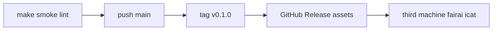

# M8 — Publication checklist

## Flow



## Before first push

| # | Check |
|---|--------|
| 1 | `git` repo initialized |
| 2 | `.gitignore` excludes `artifacts/{datasets,models,results,hf_cache}` and `.env` |
| 3 | `make smoke` and `make lint` green |
| 4 | Remote created; `main` pushed |
| 5 | Tag `v0.1.0` |

## Release assets (large — do not commit)

| Asset | Place at |
|-------|----------|
| `van_v2_final_model.pt` | `artifacts/models/van/v2/final_model.pt` |
| `best_threshold_params.json` / `best_trial_params.json` | same directory |
| `stereoset_splits.zip` | extract under `artifacts/datasets/splits/` |
| `baseline_van_v2_icat.json` | also in repo `configs/baselines/` |
| `manifest.sha256.json` | `artifacts/` → `fairai manifest --verify` |

## Verify after download

```bash
pip install -e ".[torch,dev]"
# place Release assets under artifacts/
make smoke
docker compose --profile ci run --rm smoke
FAIRAI_DEVICE=cpu docker compose --profile eval run --rm eval
fairai icat --subset all --baseline configs/baselines/baseline_van_v2_icat.json
```

## Baseline ICAT (VAN v2, subset=all)

| Metric | Value |
|--------|------:|
| avg_icat | ≈ **96.10** |
| n | 12687 |
| File | `configs/baselines/baseline_van_v2_icat.json` |

Published: https://github.com/dany27041991/fairai/releases/tag/v0.1.0
