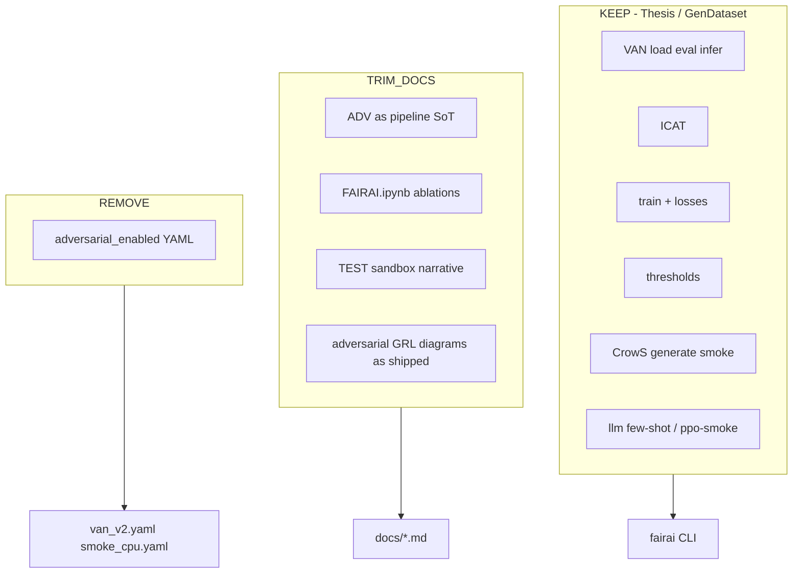
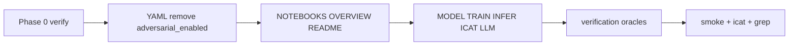

# Plan — remove non-SoT notebook surface from `fairai`

**Status (2026-10-24): DONE** — YAML `adversarial_enabled` removed; docs SoT = GenDataset → Thesis; legacy notebooks demoted.

**SoT (only):**

1. `TESI MAGISTRALE/DEVELOP/FAIRAI-Thesis.ipynb`
2. `TESI MAGISTRALE/DEVELOP/FAIRAI-GenerationDataset.ipynb`

**Out of authority:** `FAIRAI-Adversarial Network.ipynb`, `FAIRAI.ipynb`, `TEST.ipynb`, `.ipynb_checkpoints/*`.

**Finding (multi-agent analysis):** product **code** is already Thesis + GenerationDataset aligned. Cleanup is **docs + dead config**, not a large code deletion. See [CODEBASE_MAP.md](CODEBASE_MAP.md).

---

## Phase 0 — Verify once (before edits)

| ID | Check | Pass criteria |
|----|-------|---------------|
| V1 | `best_trial_params` / YAML: no live adversarial train for v2 | `adversarial_enabled` false or absent; ckpt has no discriminator keys |
| V2 | Wave B/C/G still PASS after doc/YAML edits | `make smoke`; ICAT baseline unchanged |
| V3 | Thesis cell 1 contains Focal/BiasAware/train (not only “eval”) | already confirmed by agents — cite Thesis only |

---

## Phase 1 — Code / config (minimal)

| Action | Path | Why |
|--------|------|-----|
| **DELETE** key `adversarial_enabled` | `configs/models/van_v2.yaml`, `configs/experiments/smoke_cpu.yaml` | Dead field (ADV-era); unread by loader |
| **DO NOT** add Optuna / GRL / discriminator modules | — | Not required for frozen v2; GAP-G4 stays |
| **DO NOT** remove `ppo_smoke` / `synonyms` / Compose | — | Thesis / GenDataset smoke contracts |
| Optional later | Split `cli/main.py` if growing | Maintainability only, not SoT |

**No REMOVE_CODE for VAN/ICAT/train/generate/llm** — those map to Thesis or GenerationDataset.

---

## Phase 2 — Documentation rewrite (main work)

### 2.1 Authority rewrite

| File | Change |
|------|--------|
| [NOTEBOOKS.md](NOTEBOOKS.md) | Canonical order = **GenerationDataset → Thesis** only. Move ADV / FAIRAI / TEST / checkpoints to appendix **“Legacy (non-SoT)”**. |
| [OVERVIEW.md](OVERVIEW.md) | Stage table: train/ICAT/infer/thresholds/LLM → **Thesis**; factory → **GenerationDataset**. Drop ADV / FAIRAI.ipynb as primary rows. |
| [docs/README.md](README.md) | Intro lists only the two SoT notebooks; legacy one-liner. |
| Root [../README.md](../README.md) | Optional sentence naming the two notebooks. |

### 2.2 Re-attribute “ADV / Thesis” → Thesis

| File | Change |
|------|--------|
| [MODEL_VAN.md](MODEL_VAN.md) | Header = Thesis. Remove or footnote “Optional adversarial branch” + BiLSTM/no-BPL (FAIRAI.ipynb). Drop `adversarial_enabled` from hparam table. |
| [TRAIN.md](TRAIN.md) | Provenance = Thesis. ADV `fairai_dataset_filtered` → footnote “legacy ADV path, not imported”. Remove TEST trial-count claims. |
| [INFERENCE.md](INFERENCE.md) | Drop ADV; Optuna thresholds = Thesis. |
| [EVAL_ICAT.md](EVAL_ICAT.md) | Oracle = Thesis (ADV had equivalent cells — optional footnote). |
| [LLM.md](LLM.md) | Provenance = Thesis only; FAIRAI/TEST → “not ported”. |
| [ARTIFACTS_AND_RESULTS.md](ARTIFACTS_AND_RESULTS.md) | Soften `adversarial_network.log` (shared log name; not ADV-only SoT). |

### 2.3 Verification oracles

| File | Change |
|------|--------|
| [verification/03_WAVE_C_icat_parity.md](verification/03_WAVE_C_icat_parity.md) | Oracolo AS-IS → **Thesis ICAT** |
| Other waves | Grep `ADV` / `Adversarial` / `FAIRAI.ipynb` / `TEST` → replace or delete |
| [verification/GAPS.md](verification/GAPS.md) | Keep E4/F5/G4; ensure wording cites Thesis/GenDataset |

### 2.4 External AS-IS pack (optional, outside fairai)

`TESI MAGISTRALE/00_ASIS_FOR_REWRITE/11_addendum_agent_deep_dive.md` — **updated** (SoT = GenDataset + Thesis only).

---

## Phase 3 — Acceptance

| Criterion | Evidence |
|-----------|----------|
| Docs never present ADV / FAIRAI.ipynb / TEST as canonical pipeline | Grep docs |
| YAML has no `adversarial_enabled` | `rg adversarial configs/` empty |
| `make smoke` green | CI / local |
| ICAT baseline still matches | `fairai icat --subset all --baseline configs/baselines/…` |
| [CODEBASE_MAP.md](CODEBASE_MAP.md) + this plan linked from [docs/README.md](README.md) | Index updated |

---

## Explicit non-goals

| Item | Why keep |
|------|----------|
| Multi-source generate + optional CoLA | GenDataset pools wired; Ollama residual (GAP-E4 follow-up) |
| Frozen YAML instead of Optuna | Thesis winner already baked in |
| VAN-judge few-shot + REINFORCE ppo-smoke | Thesis MC contract without Qwen weights (GAP-F5) |
| Compose profiles | Ops wrappers, not notebook SoT |
| Imported ADV-era log files on disk | Not part of fairai source |

---

## Suggested execution order

**Estimate:** ~0.5–1 day (mostly prose). Code change: &lt;10 lines YAML.

---

## Decision summary

| Area | Action |
|------|--------|
| VAN / ICAT / train / thresholds / CrowS smoke / LLM smoke | **KEEP** |
| Optuna live / full GenerationDataset / real Qwen PPO | **KEEP absent** + gaps |
| Adversarial code | **Already absent** |
| `adversarial_enabled` YAML | **REMOVE** |
| Docs naming ADV/FAIRAI/TEST as SoT | **REWRITE** |
