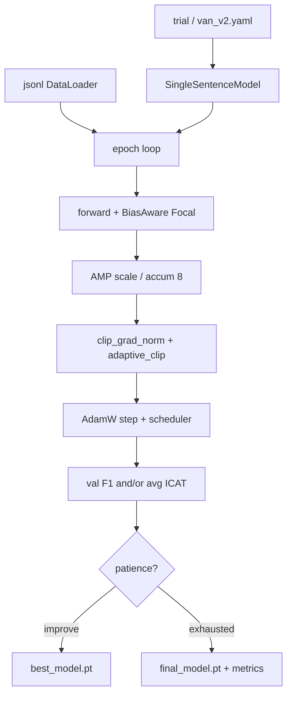
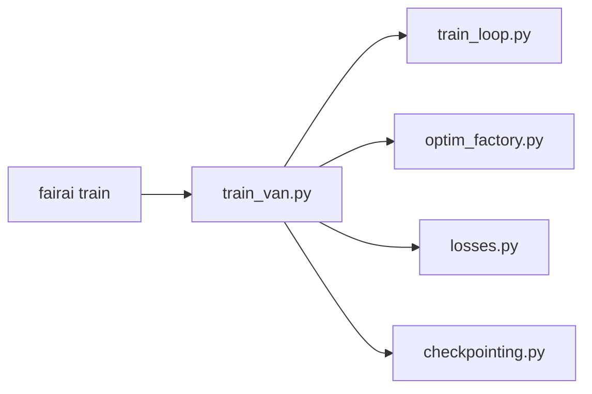

# Training VAN

From **`FAIRAI-Thesis.ipynb`** (cell 1) and `fairai train`.

## Datasets

| Use | Path | Rows |
|-----|------|-----:|
| **Canonical Thesis** | `processed/van_train_leakage_safe.jsonl` | 50409 |
| Smoke | `van_minimal_24k.jsonl` + `--max-samples` | ≤256 typical |

> Legacy path `fairai_dataset_filtered.jsonl` (backup/v3) is **not** used for parity.

## Training loop (AS-IS)



| Step | Detail |
|------|--------|
| Loss | Focal + BiasAware × Thesis `compute_class_weights` |
| Sampler | `WeightedRandomSampler` (inverse class freq; `train.weighted_sampler`) |
| Optim | AdamW + cosine/linear warmup |
| Accum | `grad_accum_steps=8` |
| AMP | CUDA GradScaler |
| Clip | `clip_grad_norm_(1.0)` + `adaptive_clip_grad(clip_factor)` |
| Early stop | Thesis Optuna: WHM(F1, iCAT); fairai retrain: val F1 macro |
| Combined score | `domain.icat.compute_combined_score` (F1_WEIGHT=1.88) — Optuna objective helper |

## Optuna fair compare (wired)

Equal-budget TPE + MedianPruner HPO for Table B protocol (WHM on StereoSet-**train**
iCAT; report test iCAT after final seeds). Closes GAP-G4 for matched families.

```bash
# Smoke (2 trials, tiny data)
make optuna-smoke FAIRAI_DEVICE=cuda

# Full studies (100 trials / family; order CE → −BPL → VAN)
make optuna-fair-ce
make optuna-fair-nobpl
make optuna-fair-van

# Final 3-seed trains + compare → artifacts/results/metrics/optuna_fair_compare.json
make optuna-fair-finalize
```

| Item | fairai |
|------|--------|
| CLI | `fairai experiment optuna -f van\|ce\|no_bpl` |
| Trials | 100 / family (smoke: 2) |
| Trial train | `--trial-epochs 10 --trial-patience 3 --max-samples 4096` (search); final suite = full split |
| Objective | `compute_combined_score` (F1_weight 1.88) |
| Storage | `artifacts/optuna/optuna_fair_<family>/study.db` |
| Best | `best_config.yaml` + `best_trial_params.json` |

Released product still ships frozen `configs/models/van_v2.yaml` (historical thesis winner).
Historical notebook Optuna remains provenance for Table A; fair-compare re-searches with
anti-peek `icat_subset: train`.

## fairai CLI

### Smoke (CPU)

```bash
make train-smoke
# fairai train -c configs/experiments/smoke_cpu.yaml --device cpu --max-samples 256
```

| Output under `artifacts/models/runs/<run_id>/` | |
|-----------------------------------------------|---|
| `best_model.pt` | best val F1 |
| `final_model.pt` | last epoch |
| `metrics.json` | history, n_train/val, device |
| `config.snapshot.json` | resolved YAML |

`smoke_cpu.yaml` inherits v2 loss/optim but uses a **tiny** MLP (2×512) for CPU.

### Full VAN v2 (GPU)

```bash
fairai train -c configs/models/van_v2.yaml --device cuda
```

| Setting | Value |
|---------|------:|
| batch | 64 |
| accum | 8 |
| epochs | 100 |
| patience | 5 |
| AMP | on |

### Compose

```bash
docker compose --profile train run --rm trainer
```

## Module map



| Piece | Path |
|-------|------|
| Use-case | `application/train_van.py` |
| Loop | `torch_van/train_loop.py` |
| Optim / clip | `torch_van/optim_factory.py` |
| Loss | `torch_van/losses.py` |

Architecture: [MODEL_VAN.md](MODEL_VAN.md).

## Baselines & ablations (IEEE / paper metrics)

Configs under `configs/experiments/`. Same train loop as VAN; flags control architecture/loss.

| Experiment | Config | What changes |
|------------|--------|----------------|
| VAN (reference) | `models/van_v2.yaml` | full BiasProjection + BiasAware + weights |
| Baseline CE | `experiments/baseline_ce.yaml` | no BPL, plain CE, no class weights/sampler |
| Ablation −BPL | `experiments/ablation_no_bias_proj.yaml` | Identity instead of BiasProjection |
| Ablation −weights | `experiments/ablation_no_class_weights.yaml` | penalties=1, no CW, no sampler |
| Baseline frozen LR | `experiments/baseline_frozen_lr.yaml` | MiniLM encode + LogisticRegression |

### Train one experiment

```bash
# neural (VAN / CE / ablations)
fairai train -c configs/experiments/baseline_ce.yaml --device cuda

# frozen SBERT + LR
fairai experiment train-lr -c configs/experiments/baseline_frozen_lr.yaml --device cuda
```

### Metrics (F1 + iCAT) for a run

```bash
fairai experiment eval-run \
  -r artifacts/models/runs/<run_id> \
  -d artifacts/datasets/processed/van_train_leakage_safe.jsonl \
  --splits-dir artifacts/datasets/splits/stereoset \
  --device cuda
# → <run_dir>/eval_report.json  (f1_macro, avg_icat, …)
```

### Compare several runs (paper table)

```bash
fairai experiment compare \
  -r artifacts/models/runs/full-van-v2 \
  -r artifacts/models/runs/full-baseline-ce \
  -r artifacts/models/runs/full-ablation-nobpl \
  -r artifacts/models/runs/full-frozen-lr \
  -d artifacts/datasets/processed/van_train_leakage_safe.jsonl \
  --splits-dir artifacts/datasets/splits/stereoset \
  -o artifacts/results/metrics/baselines_compare.json \
  --device cuda
```

### Suite (train + compare)

```bash
# CPU smoke (~minutes if HF cache warm)
fairai experiment suite -c configs/experiments/suite_smoke.yaml --device cpu

# Full GPU paper suite
fairai experiment suite -c configs/experiments/suite_full.yaml --device cuda
```

`suite_*.yaml` lists experiment configs; output table has `eval_f1_macro` + `avg_icat` per row.

### Rigorous ablation suite (matched protocol)

Fixed split `van_split_seed42_{train,val}.jsonl`, early-stop on Thesis
WHM(F1, iCAT) (`train.selection_metric: combined`), one-factor ablations,
3 init seeds → mean±std.

```bash
# Historical matched suite (rig-*); WHM once peeked StereoSet-test iCAT
FAIRAI_SUITE=configs/experiments/suite_rigorous.yaml \
  docker compose --profile experiment run --rm experiment-gpu
# → artifacts/results/metrics/rigorous_ablation_compare.json
# → artifacts/results/metrics/rigorous_ablation_compare_agg.json

# Clean retrain (rigc-*); WHM uses StereoSet-train iCAT (icat_subset: train)
make compose-experiment-rigorous-clean
# → artifacts/results/metrics/rigorous_clean_compare.json (+ _agg.json)
```
