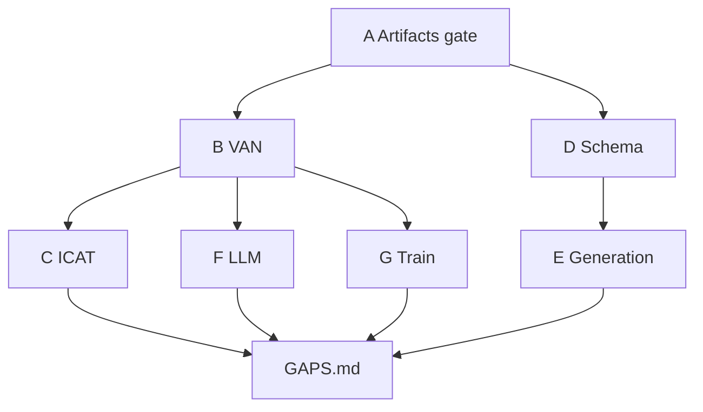

# Anti-regression verification — INDEX

**Scope:** AS-IS (`TESI MAGISTRALE`) → TO-BE (`fairai/`)  
**Started:** 2026-10-21  
**Closed:** 2026-10-21  
**Rule:** notebooks = static oracle; CLI/tests = executable truth. No full `.ipynb` re-exec.

## Wave dependency graph

## Scorecard

| Wave | File | Status | Blocker? | Notes |
|------|------|--------|----------|-------|
| A Artifacts | [01_WAVE_A_artifacts.md](01_WAVE_A_artifacts.md) | **PASS** | yes | counts + manifest |
| B VAN checkpoint | [02_WAVE_B_van_checkpoint.md](02_WAVE_B_van_checkpoint.md) | **PASS** | yes | strict load, hparams 23/23 |
| C ICAT parity | [03_WAVE_C_icat_parity.md](03_WAVE_C_icat_parity.md) | **PASS** | yes | baseline avg_icat 96.0973 |
| D Dataset schema | [04_WAVE_D_datasets_schema.md](04_WAVE_D_datasets_schema.md) | **PASS** (+GAP-D4) | no | 17 residual overlaps follow-up |
| E Generation | [05_WAVE_E_generation.md](05_WAVE_E_generation.md) | **PASS** (GAP-E4 follow-up: Ollama) | no | multi-source + CoLA optional |
| F LLM prompts | [06_WAVE_F_llm_prompts.md](06_WAVE_F_llm_prompts.md) | **PASS** (+GAP-F5) | no | MC 1484/317/322 |
| G Train config | [07_WAVE_G_train_config.md](07_WAVE_G_train_config.md) | **PASS** (+GAP-G4) | no | YAML↔trial params |

**Verdict:** A–C blockers **PASS**. No rewrite regression vs AS-IS oracles for gated checks.  
**Gaps:** [GAPS.md](GAPS.md) (0 blockers; 0 follow-up; 3 accepted; GAP-D4 closed)  
**Evidence:** [EVIDENCE/](EVIDENCE/)

## Oracles

- AS-IS pack: `../TESI MAGISTRALE/00_ASIS_FOR_REWRITE/`
- Baseline ICAT: `configs/baselines/baseline_van_v2_icat.json`
- Artifacts: `artifacts/`

## Closure criteria

- [x] Waves A–C all **PASS**
- [x] D–G **PASS** or explicit **accepted/follow-up** gaps
- [x] No `.pt` / large jsonl committed as evidence
- [x] Link from [docs/README.md](../README.md)
